<p align="center">
  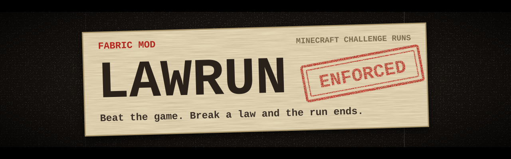
</p>

<p align="center">
  <b>Minecraft challenge runs where the game itself enforces the rules.</b><br>
  Break a law and the run ends, and the game tells you which law and why.
</p>

<p align="center">
  <a href="https://github.com/OppaiMaster7/LawRun/releases/latest"></a>
  <a href="https://github.com/OppaiMaster7/LawRun/releases"></a>
  
  
  <a href="https://github.com/OppaiMaster7/LawRun/actions/workflows/build.yml"></a>
  <a href="LICENSE"></a>
</p>

<p align="center">
  <a href="https://github.com/OppaiMaster7/LawRun/releases/download/v0.1.0/lawrun-0.1.0.jar"></a>
  <br>
  <sub><a href="https://github.com/OppaiMaster7/LawRun/releases">All versions</a> · <a href="#install">How to install</a></sub>
</p>

<p align="center">
  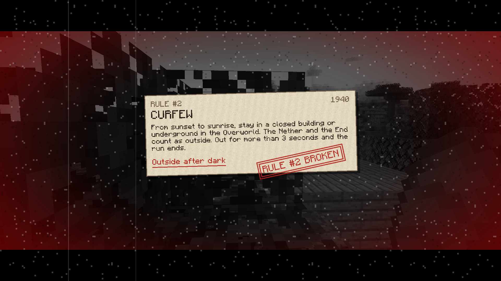
</p>

## What it is

**LawRun** is a series of Fabric mods that turn GuyBordo's "Beating Minecraft,
But I Can't Break the Laws of X" videos into challenges you can play yourself.
In the videos he has to keep track of the rules. Here the game does it: it
blocks what's banned, counts down what's timed, takes what's confiscated, and
ends the run the moment a law is broken.

One run is out so far:

| Run | Video | Status |
|---|---|---|
| **1940s Germany** | [I Beat Minecraft Without Breaking the Laws of 1940's Germany](https://www.youtube.com/watch?v=oEDzhaMs0Iw) | **Playable**, all six laws enforced |

## Run #1: 1940s Germany

> [!IMPORTANT]
> In this run you play under laws the Nazi government imposed on Jewish people
> in Germany between 1938 and 1941, steps in a persecution that ended in the
> Holocaust. **You are always the person the laws were written against, never
> the one enforcing them.** The laws were real; here they are simplified so
> they work as game rules. The mod has no Nazi imagery, no enforcer
> characters, and no jokes on the rule text. It is a game adaptation of a
> video, not a history lesson. To learn what really happened, start with the
> [US Holocaust Memorial Museum](https://www.ushmm.org/).

Six laws, one life, and the Ender Dragon at the end.

| # | Law | In the game |
|---|---|---|
| 1 | **Weapons ban** (November 1938) | Nothing that deals attack damage: no swords, tools, bows or crossbows. Crafting one is blocked. Picking one up ends the run. TNT is allowed. |
| 2 | **Curfew** (1940) | From sunset to sunrise you must be in a closed building or underground. Three seconds outside and the run ends. The Nether and the End count as outside. |
| 3 | **Confiscation of property** (1938 onward) | At every sunrise everything you carry is taken, armor included. Chests you placed are emptied too. Chests the world generated are safe. |
| 4 | **Rationing** (1939 onward) | At sunrise you keep 3 random pieces of the food you carry. |
| 5 | **Exclusion from business** (November 1938) | Trading with villagers or wandering traders, or bartering with piglins, ends the run. |
| 6 | **Emigration ban** (October 1941) | A 256 × 256 border surrounds spawn. A travel permit costs 3 diamonds and lifts it. |

Dying ends the run. Killing the Ender Dragon wins it.

You also get one **safe pocket**: an extra inventory slot whose stack survives
sunrise. It isn't in the video. It's there so a run is hard, not hopeless.

Every rule, with the timestamp where it's stated in the video and every
decision made where the video is vague, is in
[`docs/runs/germany-1940s.md`](docs/runs/germany-1940s.md).

## Install

You need **Minecraft 26.3** with **Fabric**.

1. Install [Fabric Loader](https://fabricmc.net/use/installer/) (0.19.5 or newer) for Minecraft 26.3.
2. Download [Fabric API](https://modrinth.com/mod/fabric-api) for 26.3.
3. Download **[lawrun-0.1.0.jar](https://github.com/OppaiMaster7/LawRun/releases/download/v0.1.0/lawrun-0.1.0.jar)**
   (or pick a version on the [releases page](https://github.com/OppaiMaster7/LawRun/releases);
   take the `.jar`, not the "Source code" zips).
4. Put both `.jar` files in your `mods` folder (`%appdata%\.minecraft\mods` on Windows).
5. Start the game with the Fabric profile.

It's built and tested for singleplayer.

## Play

Create a **survival** world. A few seconds after you join, the mod says hello
with a **[START]** button in chat: press <kbd>T</kbd> and click it. You get a
disclaimer, then the six laws dealt out as cards, then **Begin**.

Press <kbd>J</kbd> at any time to read the laws again.

| Command | Who | What |
|---|---|---|
| `/lawrun list` | anyone | Runs available |
| `/lawrun rules [run]` | anyone | Open the laws for reference (also <kbd>J</kbd>) |
| `/lawrun intro germany_1940s` | anyone | Disclaimer, then the intro reel (what the START button does) |
| `/lawrun start germany_1940s` | anyone | Start the run straight away |
| `/lawrun status` | anyone | Current run, time so far, or why it ended |
| `/lawrun permit` | anyone | 1940s Germany: pay 3 diamonds to lift the border |
| `/lawrun fail <reason>` | cheats | Fail the run on purpose, for testing |
| `/lawrun reset` | cheats | Forget the run, lift the border and go back to survival |

## What it looks like

Everything is presented as a 1940s newsreel: the world is graded sepia or
grey, with film grain, letterbox bars, rubber stamps and typewriter text.
Every sound is a vanilla one.

<table>
  <tr>
    <td width="50%">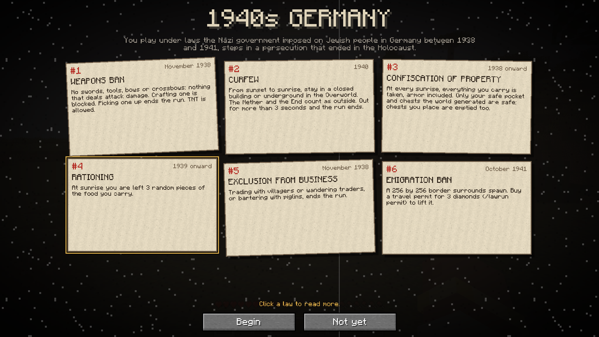<br><sub><b>The intro.</b> The six laws, dealt onto the table as paper cards. Click one to read more.</sub></td>
    <td width="50%">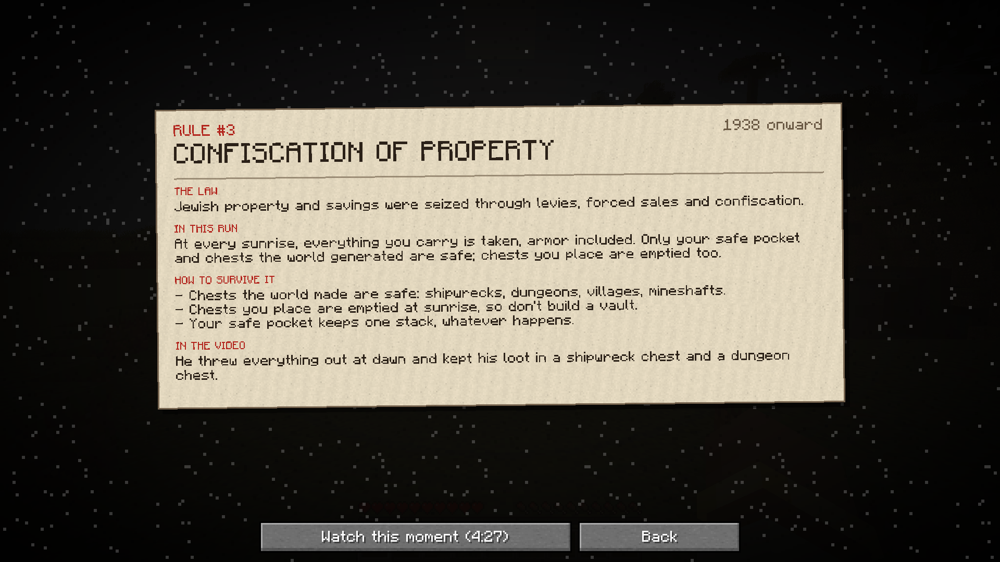<br><sub><b>Law pages.</b> The real law, how the run enforces it, how to survive it, and a link to that moment in the video.</sub></td>
  </tr>
  <tr>
    <td>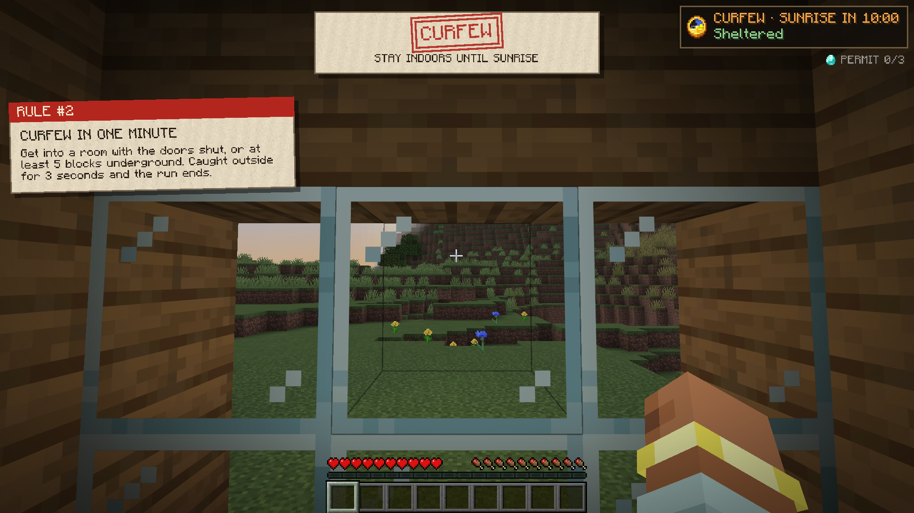<br><sub><b>Sunset.</b> Bells toll, the CURFEW banner drops, and a notice explains what counts as shelter.</sub></td>
    <td>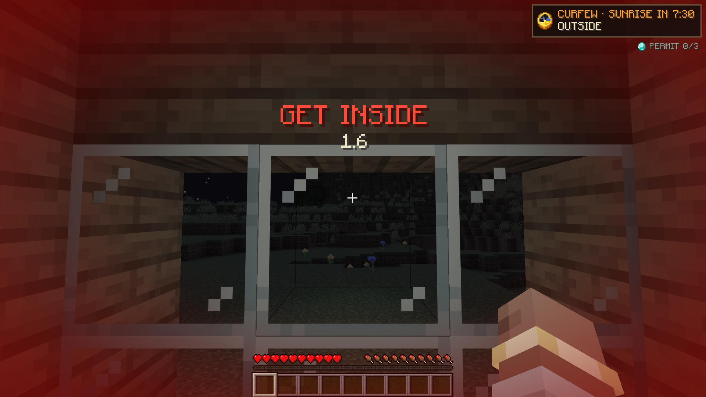<br><sub><b>Caught outside.</b> A red pulse, a heartbeat and three seconds to get back in.</sub></td>
  </tr>
  <tr>
    <td>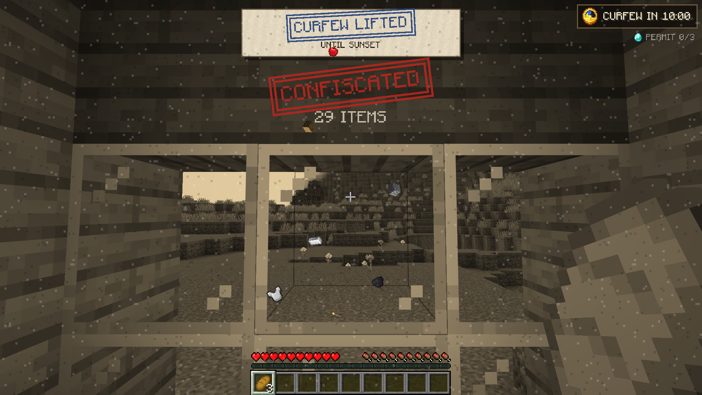<br><sub><b>Sunrise.</b> Everything you carried flies out of your hotbar. Three random pieces of food are handed back.</sub></td>
    <td>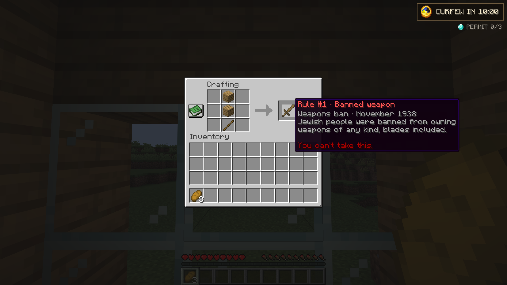<br><sub><b>Rule #1.</b> The crafting table shows the banned weapon, but won't let you take it.</sub></td>
  </tr>
  <tr>
    <td>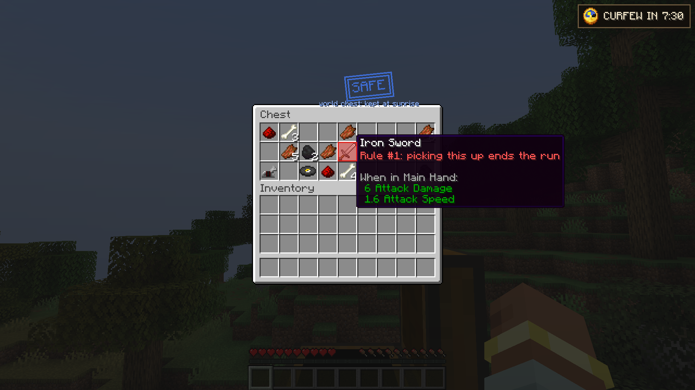<br><sub><b>Chests.</b> Chests the world generated are stamped SAFE. Weapons are marked red.</sub></td>
    <td>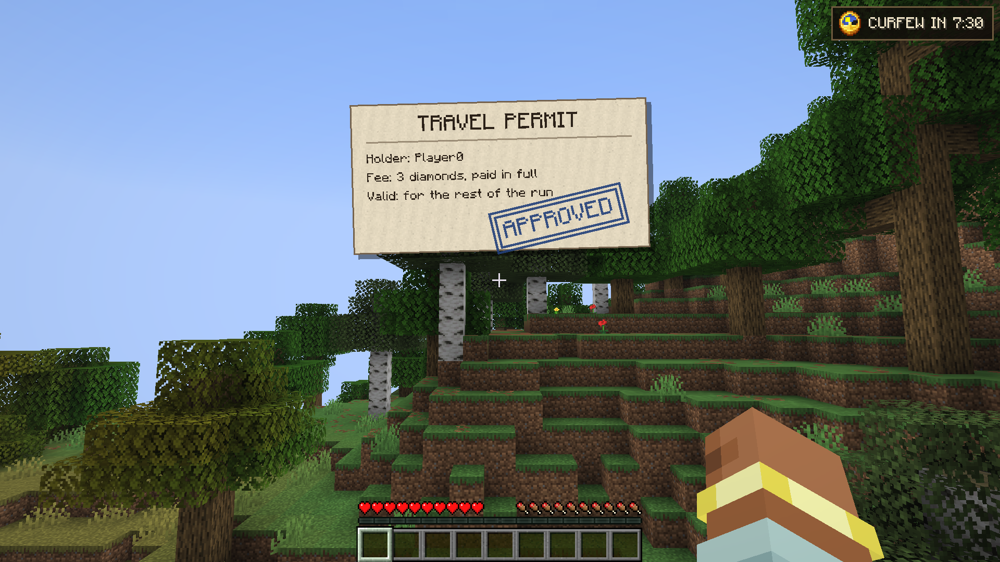<br><sub><b>The permit.</b> Three diamonds buy a travel permit. APPROVED.</sub></td>
  </tr>
  <tr>
    <td>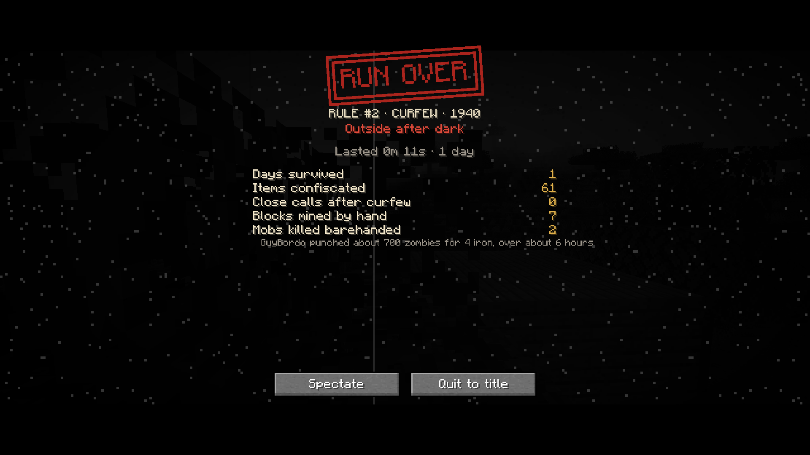<br><sub><b>Run over.</b> Your stats, and GuyBordo's for comparison.</sub></td>
    <td>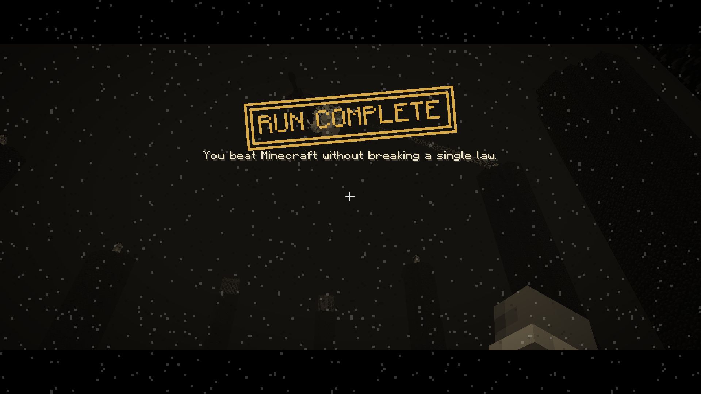<br><sub><b>Victory.</b> The dragon dies: RUN COMPLETE. The exit portal then plays the mod's own ending.</sub></td>
  </tr>
</table>

All 20 screenshots, with descriptions, are in [`docs/mod-page/`](docs/mod-page/).

<details>
<summary><b>Every cinematic, moment by moment</b></summary>

<br>

| Moment | What happens |
|---|---|
| Start | **[START]** in chat opens a red **DISCLAIMER**, then the intro reel: the title types out, the six laws are dealt as paper cards, then **Begin**. Click a card for its law page |
| Mid-run | <kbd>J</kbd>, the chat's **[Laws]** button, or **The Laws** on the pause menu bring the laws back for reference |
| Curfew | Timer plate with a ticking clock; the edges darken in the last minute and tick in the last 10 s; at sunset bells toll and a CURFEW banner drops; outside after dark gives a red pulse, a heartbeat and a shaking GET INSIDE countdown; "Made it." on a close call |
| Sunrise | A "DAY N" card, the world goes sepia, everything you carried flies out of the hotbar, CONFISCATED stamps down with the count, your 3 rations are handed back |
| Permit | A travel permit slides up and is stamped APPROVED |
| Rule broken | World drains to grey, the rule card slams in and types itself out, RULE #N BROKEN stamps down, fade to black, then the **RUN OVER** screen with your stats and GuyBordo's for comparison |
| Dragon dies | Sepia, bells, gold RUN COMPLETE stamp; the exit portal then plays **the ending**: title, the record, credit to the video, a short factual epilogue, credits, Continue |

The stats counted are days survived, items confiscated, close calls, blocks
mined by hand (real blocks only, not grass) and mobs killed barehanded.

Paper notices slide in from the left as things become relevant, once per run:

- **Rule tutorials:** the travel permit when you reach the border, a diamond
  tracker, a shelter lesson a minute before the first sunset, rationing and
  the safe pocket with your first food, villagers and piglins, the Nether and
  the End, placing a chest.
- **A warning** when a weapon is lying within reach.
- **Callbacks to GuyBordo's run:** snowballs, TNT, spawners, a 22-block fall,
  rotten flesh, ender pearls, blaze rods, world chests, beds in the End, the
  lone sheep.

On screens:

- **Chests** are stamped SAFE (the world made it) or NOT SAFE (you placed it).
- **The trade screen** says TRADING BANNED.
- **Weapons in containers** are marked red, with a warning in their tooltip.
- **The curfew plate** tracks diamonds toward the permit. In the Nether and
  End it counts down to "RETURN BY SUNSET".

</details>

## Status

This is an early release (**0.1.0**). All six laws are enforced, and an
automated in-game test plays through every one of them. Not done yet:

- Nobody has played it start to finish against the real dragon. The win and
  the ending are tested, but by triggering the win directly.
- There is no config file. The border size and the 3-second grace period are
  fixed.
- The known gaps are listed in
  [`docs/runs/germany-1940s.md`](docs/runs/germany-1940s.md#known-gaps).

Found a bug? [Open an issue](https://github.com/OppaiMaster7/LawRun/issues).

## The series

The plan is one run per video, all built on one shared engine. Only the first
is built. The others wait until it's solid.

| Run | Video | Status |
|---|---|---|
| **1940s Germany** | [oEDzhaMs0Iw](https://www.youtube.com/watch?v=oEDzhaMs0Iw) | **Playable (0.1.0)** |
| Islam | [-fMkyL1q0eU](https://www.youtube.com/watch?v=-fMkyL1q0eU) | Planned |
| Mormonism | [dY3Mi7txWzQ](https://www.youtube.com/watch?v=dY3Mi7txWzQ) | Planned |
| Scientology | [djeXGgADLyE](https://www.youtube.com/watch?v=djeXGgADLyE) | Planned |
| Physics | [nFvKw-cWywM](https://www.youtube.com/watch?v=nFvKw-cWywM) | Planned |
| North Korea | [5P80oPOADh0](https://www.youtube.com/watch?v=5P80oPOADh0) | Planned |
| Judaism | [_G3bic1kp0o](https://www.youtube.com/watch?v=_G3bic1kp0o) | Planned |
| Sikhism | [ozOwwgNL-Ak](https://www.youtube.com/watch?v=ozOwwgNL-Ak) | Planned |

Each run gets a rules document in [`docs/runs/`](docs/runs/) **before** any
code: every rule as he states it, with a timestamp, the in-game translation,
and the open questions. Nothing gets enforced from guesswork.

## Credit and ground rules

Every run is **GuyBordo's** design. The rules come from his videos, and the
mod credits him and links the video in every briefing and in the ending.

LawRun is an unofficial fan project. It is not affiliated with or endorsed by
GuyBordo, and it isn't an official Minecraft product. If he wants his name
off it, or wants it taken down, that's what happens.

- Rule text is factual. The humour comes from how hard it is, never from the
  people the rules were written about.
- Each briefing says the rules are a game adaptation of his video, not
  history or religious guidance.

The 1940s Germany run has extra guardrails, listed at the bottom of
[its rules document](docs/runs/germany-1940s.md#guardrails-specific-to-this-run).

## For developers

<details>
<summary><b>Build, test, and how the code is split</b></summary>

<br>

Fabric on Minecraft 26.3 (Fabric API 0.161.0, Java 25).

```bash
./gradlew build       # the jar lands in build/libs/
./gradlew runClient   # launch the game with the mod
```

### How the code is split

```
com.bogi.lawrun
├── core/        the engine; knows nothing about any particular run
│   ├── RunState        one player's attempt: active / failed / won, saved on the player
│   ├── RunManager      start, fail (rule card, then "RUN FAILED"), win; death fails, the dragon wins
│   ├── RunDefinition   a run's title, context, source video, laws and hooks
│   ├── RunHooks        what a run adds: start, tick, end, reset
│   └── LawRunCommand   /lawrun
├── runs/germany/  the 1940s Germany run: one class per law, plus the safe pocket
├── mixin/       hooks into vanilla (crafting output, slots, trades, piglins, inventory, the End credits)
├── net/         server → client packets that trigger each cinematic
└── client/      everything you see
    ├── anim/      the newsreel toolkit: easing, film grain, stamps, typewriter, paper, a cue clock
    ├── screen/    intro, fail ("RUN OVER") and ending screens
    └── *Cinematic / CurfewHud   the in-world moments: arrest, sunrise, permit, victory, curfew
```

Adding a run means a new package under `runs/`, a `RunDefinition` and one
line in `LawRun.onInitialize`. Rules that repeat across runs (banned items,
a timer, trade bans) move into `core/` the second time they're needed, not
before. Whether the runs ship as separate jars or as one mod with a run picker
gets decided when run #2 exists. For now there is one jar.

### Automated test

```bash
./gradlew runClientGameTest
```

Opens the game, makes a flat test world and plays through the whole run: the
welcome and intro (clicking the real Begin button), the timer, the safe pocket,
Rule #1 in a crafting table, the permit, stat counting, sunrise confiscation
and rations, placed vs natural chests, the curfew warning, sunset, shelter, a
close call and a curfew fail, the RUN OVER screen, picking up a bow, trading,
bartering, the victory and every scene of the ending, down to Continue
respawning you, plus the disclaimer, the law pages, J, the notices, the stamps
and the block counter ignoring grass. It fails on the first thing that
misbehaves, and saves 34 screenshots to
`build/run/clientGameTest/screenshots/`. It takes about two minutes. It needs a
screen, so it isn't part of `build` or CI.

### Mod page screenshots

```bash
./gradlew runClientGameTest -Pmodpage
```

Retakes the 20 mod page screenshots at 1920x1080 in a seeded world with
scenery (a village, a house, the border, the End). They end up in
`build/run/clientGameTest/screenshots/`; the current set, with a description
for each, is in [`docs/mod-page/`](docs/mod-page/).

</details>

## License

[CC0-1.0](LICENSE). Made by Bogi.
